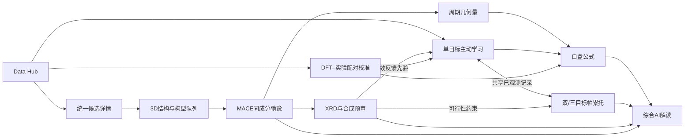
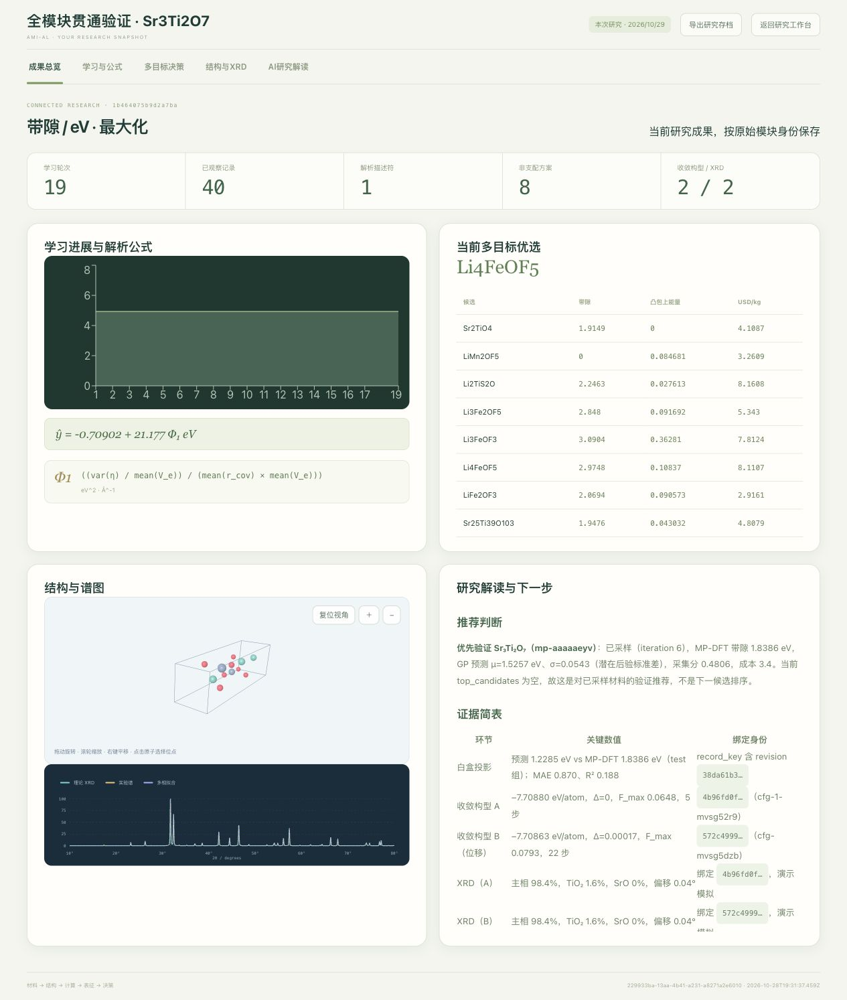
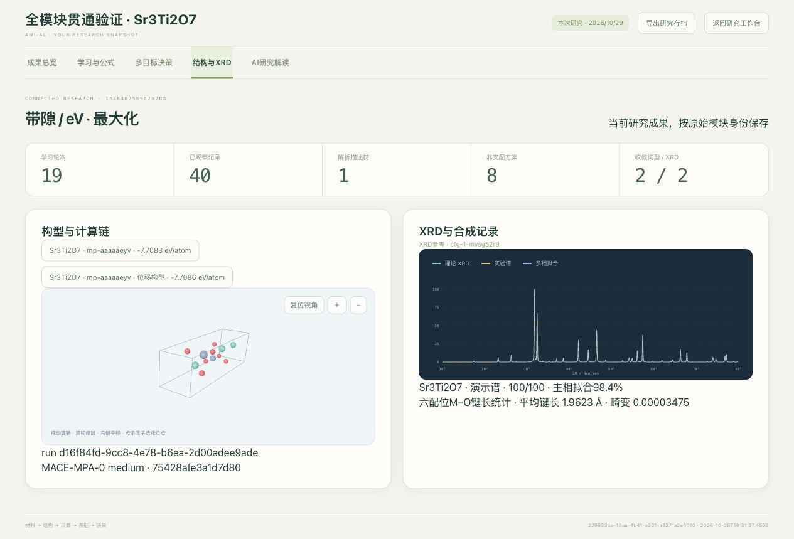

# 统一研究工作流

研究工作台围绕完整材料身份 `recordKey` 联动各模块；结构另以 SHA256、原始版本和计算运行标识区分。固定路演入口继续保留，自己的研究则通过“展示本次研究”展示。



## 从候选到研究结论

1. 在 Data Hub 选择数据、目标和条件组并加载。全局“材料联动”、材料表和前沿候选均可打开同一详情，继续进入3D、构型队列、XRD、公式或综合解读。
2. 从候选详情加入 uMLIP 队列；可继续导入相同元素计数、顺序及运动约束的构型，或生成首构型的小位移候选。切换材料时先“新建同成分队列”，已完成运行可从历史重新打开。启动后按实际收敛结果训练构型能量模型。
3. 选择已弛豫构型，点击“当前结构 → XRD”。后端核验原始记录与父几何，保留模型及运行来源；导入实验 `.xy`/`.csv` 比对后可反馈学习。模拟体验谱保持演示身份。
4. 有效反馈同时影响单目标获取分数、多目标后续采样与当下优选。原始物性值和已观测前沿保留，低可行性候选从推荐中排除。
5. 点击“几何量 → 白盒公式”，选择同成分材料、金属中心、O邻域截断和可选体积参考。程序保留不同周期映像，输出键长均值/总体方差；恰有6个O邻居时计算键长畸变。提交会替换这次计算负责的四个字段，保留其他外部补充量。
6. 打开 AI 顾问并选择材料；“综合研究解读”读取实际公式投影、前沿取舍、构型能量/力、XRD绑定与几何统计，回复保留当时上下文。

## 多目标与配对校准

- 主目标跟随 Hub 的七种目标及原单位，第二性质从同一记录选择；没有第二性质时使用“性能 + 采购价”。方向及有效维度贯穿支配关系、偏好、ParEGO和HV。输入稳定性或报价后重建对应候选池。
- “带入单目标已观测”和“同步观测到单目标”按记录身份共享观察；预测与未观测标签分别处理。
- DFT + 实验库可拟合10个独立组成的常数偏差。勾选“校准预测：DFT → 实验尺度”后，这10组计为已观测，代理拟合配对DFT值，输出均值加偏差，实验原值保持不变。
- 白盒教师使用相同校准；参与偏差拟合的组成固定在发现侧，选择/测试侧继续独立。结果快照记录校准ID、单位、偏差和分区。
- 同一构型的MACE固定晶胞弛豫保持每原子体积；非零体积差需要用户选择另一个同成分晶胞参考。

## 保存、恢复和自己的路演

“保存研究”写入浏览器 IndexedDB；“导出研究存档”生成 `AI4S-research-<id>.json`；“导入存档”验证后加入存档列表。存档包含学习配置和观测、公式及分区、前沿及价格、构型和输出文件、谱图报告、几何补充量、校准及AI对话。

恢复会先取消旧前端任务，按 `{dataset,id,revision}` 重新读取本机精确源记录，恢复为暂停状态；已有完成结果不重算，未完成的自动公式搜索可继续。自有成果路演直接读取存档，按实际观测数、轮次和已有成果展示，不要求固定20轮或2个构型。原始运行不在本机时，构型结果仍可展示，派生反馈须重新关联本机来源。

材料源仍需存在于目标机器的 Hub 中，才能继续该研究；展示和已打包的构型/POSCAR/轨迹可直接从JSON读取。移机时同时携带相应Hub数据，并配置计算依赖。密钥不进入存档。

## 实现与验证

会话、校准、几何和证据汇总位于 `src/research/`。本地 `POST /api/hub/records` 按精确版本恢复记录；`GET /api/umlip/runs/:id/candidates/:candidateId/reference` 核验派生绑定。接口不回退到新版记录。

```bash
AI4S_PYTHON=/absolute/path/to/python npm test
npm run lint
npm run build
git diff --check
```

工程回归使用内存或隔离库的明确测试夹具；真实MP/MACE/XRD链路与夹具校准记录分开验证，默认库不预置实验标签。

## 界面验证截图

本次研究以40条MP观测、解析公式、8个非支配方案及2个收敛MACE构型展示完整结果。两份XRD演示谱分别绑定各自构型，点击构型后切换对应报告。




