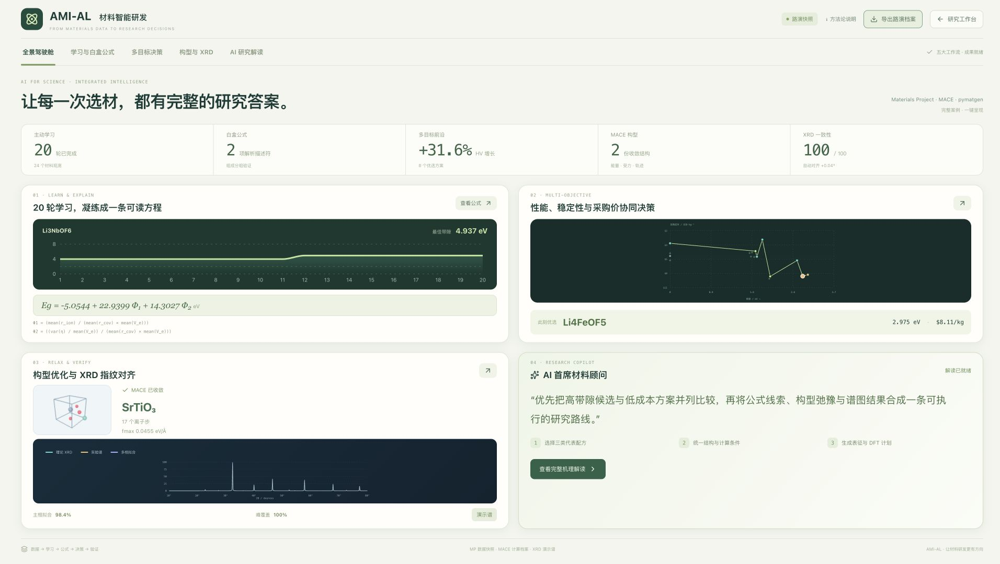
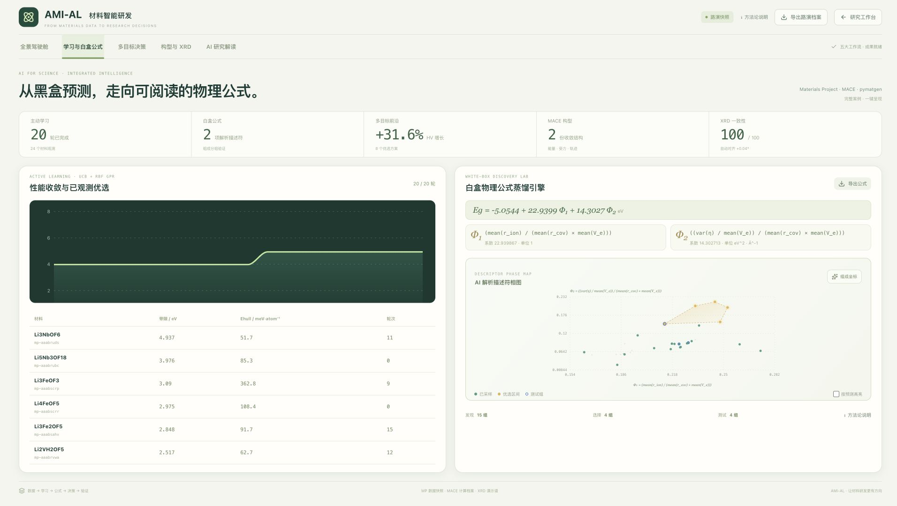
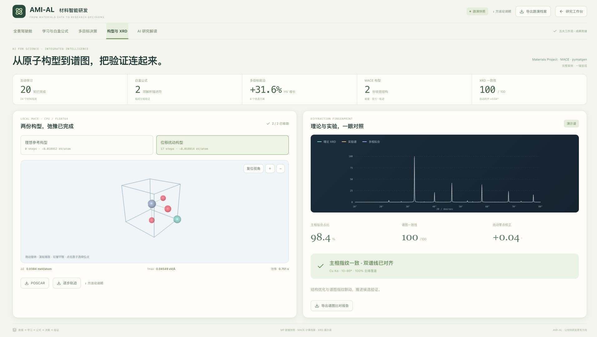

# 完整路演版验收（2026-10-29）

首页默认载入完成态：20轮主动学习、24条采样、两项白盒公式、MP三目标前沿、两份MACE收敛构型、XRD对齐结果和预置研究解读。主卡片展示结果，方法说明通过统一入口展开。

## 验证结果

- `npm run lint`、`npm run build`、`git diff --check`通过。
- `npm test`：266项通过，0失败、0跳过。科学数值检查使用已有Python运行时；本次没有重跑MACE，展示复用原真实运行的两份收敛档案。
- 五个页面在1920×1080中均可一屏呈现，页尾位置分别为1065.18、1060.89、1064.39、1070.78、1079.34像素；无横向溢出。
- 502像素窄屏无横向溢出，原白盒标题保持单行。
- 企业偏好即时改变选择，概览图与文字一致；滑条显示归一化权重；早期演进只显示当时6条观测，最终20条。
- 研究→路演→研究后，原前沿30/30、报价草稿、导入结构、顾问草稿和自动蒸馏开关均保留。
- 两份构型切换、完整路演JSON及XRD报告下载通过；导出记录保留来源与原运行身份。浏览器未记录控制台错误。

## 案例数值

MP快照上的20轮UCB使用初始采样种子2026（GPR与ParEGO种子42），共24条已观察记录；最高带隙4.9368 eV。白盒表达式由这些观察实际搜索生成。三目标20条评价得到8个非支配点，固定尺度HV增长31.58646%。

MACE来源运行 `dfce2840-6f79-489e-bb5f-3542af7c48b4`，精选`demo-0`与`demo-4`；扰动结构17步收敛，fmax=0.0454862 eV/Å。XRD由pymatgen重新计算并拟合合成演示谱，一致性99.98/100、主相拟合98.4%、校正0.04°。研究解读由Codex按这些档案预生成。

完整参数、测试误差、来源与指标口径保留在页面方法说明及JSON。机器可读记录见 [presentation-20261029.json](presentation-20261029.json)。

