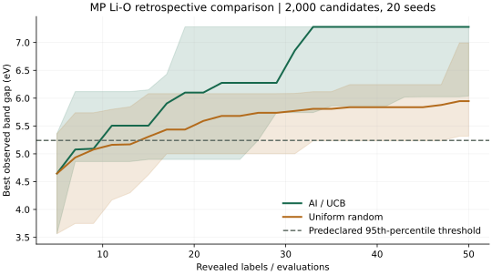
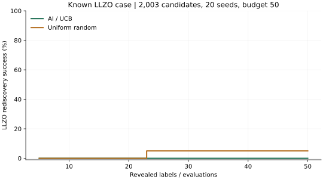

# 问鼎·材料引擎主线重塑验收

日期：2026-11-12。以下记录本轮实现与验证；线上发布状态以对应部署回执和运行版本为准。

## 产品改动

- 统一品牌、页面标题与默认流程；固态电解质场景提供 Li/O 数据、带隙与稳定性联合决策。
- 模型、策略与自定义数据收进专家模式；主入口移除示意动画、主题切换和独立模块按钮。
- 候选详情扩展为五项研究答案；真实研究与预置示例共用报告组件。
- 新增离线 HTML 报告和完整打印/PDF，保留 JSON 存档、精确版本恢复与来源标签。
- MACE 和 AI 解读按材料身份筛选；独立示例的结构与谱图不会绑定给无关候选。
- 最后一批标签评价后重新训练，刷新剩余候选预测。

## 真实 MP 多种子对照

源版本为官方 Summary 2026-09-28。Li/O 条件匹配17520条，按当前索引的 ID 顺序载入2000条；预算50，种子101–120，共20次。阈值在运行前固定为候选集带隙95百分位：5.24003 eV。AI 和均匀无放回随机使用同一组初始5条标签。AI 使用默认 RBF GPR 参数与按化学式大小代价归一化的 UCB；随机对照不使用代价或模型预测。

| 指标 | AI / UCB | 均匀随机 |
| --- | --- | --- |
| 50次预算内达到阈值 | 19/20 | 19/20 |
| 成功运行的评价次数中位数 | 11 | 15 |
| 最终最佳带隙中位数 / eV | 7.2811 | 5.94595 |
| 最终最佳值的10–90百分位 / eV | 6.03811–7.2811 | 5.31551–6.99454 |

上述次数中位数分别对成功运行计算；没有把未达标运行填成虚构次数，也未将结果转换为真实 DFT/实验费用节省或统计显著性结论。

机器记录：[20种子结果](wending-learning-20seeds.json)。输入响应 SHA256：13decfb0e80880ca6d4816372e896f773fac22dd938297c29fa384b9458d1273。

## 已知 LLZO 回溯案例

基础2000候选补入同一快照中精确 Li/La/Zr/O 查询的3条真实记录，共2003条；目标为 mp-aaacbqoz / Li7La3Zr2O12。目标组成排除出初始标签，预算50，种子101–120。

- AI 首次找到 LLZO：0/20；均匀随机：1/20，在23次评价时找到。
- 本案例仍优化带隙，不使用离子电导率或迁移标签。结果说明当前目标不支持宣称已有效重发现优秀电解质；后续须补上与用途对应的目标和数据。
- 这是一项已知材料回溯检验，没有新增合成、XRD 或 DFT 实验。

机器记录：[LLZO结果](wending-llzo-20seeds.json)。输入构造与原始查询记录保存在结果元数据中。

## 页面与工程验证

- 使用隔离数据库副本及真实 MP 响应验证2000候选、50次评价、24轮、Top 3、自动公式和联合决策。
- 已检查候选五项报告、示例报告、两份原始 MACE 档案、合成谱标记、HTML 下载、完整打印文档和研究保存恢复。
- 检查1920×1080宽屏、390px移动布局及中英文标题和 lang。
- TypeScript 检查、生产构建、diff 检查通过；Node 回归共306项：305通过，0失败，1跳过。跳过项是本机没有配置 pymatgen Python 环境的真实衍射测试；本轮未重新执行 MACE 或科学 Python 计算。
- 新增12项回归覆盖报告排序、未观测标签隔离、共享观测/重置、末批重训、存档辅助性质、历史构型保留、打印展开、HTML转义与晶胞几何。
- 独立复核后修复：决策面板打开后继续同步主池观测；重新筛选清空共享观测；切换当前构型运行仍保留历史结构与其精确谱图；打印展开全部来源和验证指标。
- 浏览器复测：决策工具随主学习从1条增至32条具备完整价格/目标的观测，主池仍只评价50次；重置后决策观测为0。
- 1920×1080：曲线与三张候选卡完整位于首屏，卡片底部约1061px；页面滚动宽度等于内容宽度1905px。
- 390px窗口：内容宽度与滚动宽度均375px，无横向溢出；可见主流程小于12px文字为0。
- 中英文 html lang 和页面标题同步；最终浏览器控制台无 error/warning。
- 打印使用完整离线文档，包含15个候选问题、2份独立结构案例、4张SVG图，全部 details 展开；示例HTML约67KB。

## 可审核交付物

- [独立 HTML 示例报告](wending-example-report.html)
- [研究主界面](images/wending-research-1920.png)
- [候选五项报告](images/wending-candidate-report.png)
- [结构与谱图验证视图](images/wending-validation-1920.png)
